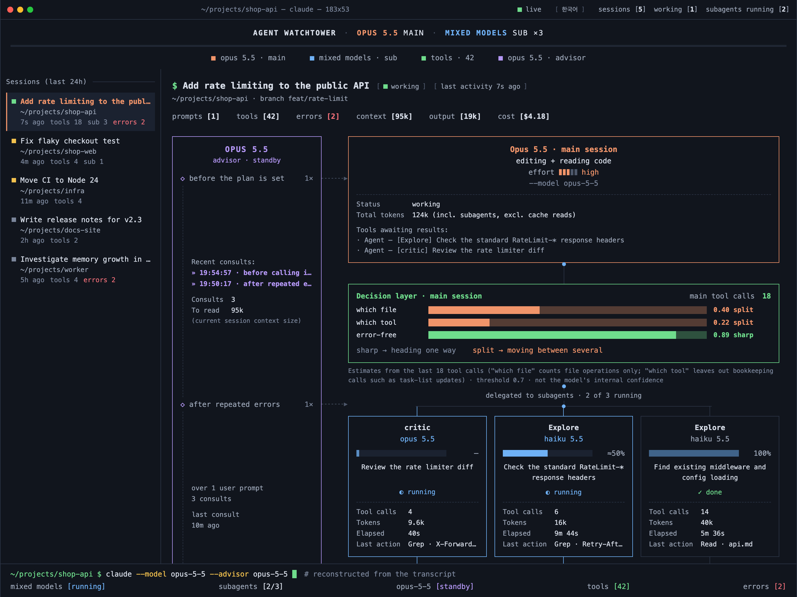

# Agent Watchtower

A local, read-only dashboard that shows what the Claude Code sessions on your machine are doing right now: the main session, its subagents, advisor calls, tool usage and a live log, drawn as a terminal-style flow chart.

[한국어 README](README.ko.md)



<sub>Screenshot made from demo transcripts (`scripts/demo-data.mjs`), not real sessions.</sub>

- **Read-only.** The dashboard only reads the session transcripts Claude Code already writes. It never changes them or your Claude Code settings. (The separate, opt-in `setup --yes` command is the only thing that writes to your config.)
- **Local only.** The server binds to `127.0.0.1` and sends nothing off your machine. No account, no telemetry, no external requests.
- **No dependencies.** Plain Node.js, no packages to install.

## What each command does

| Command | What it does |
|---|---|
| `npx agent-watchtower` | Starts the dashboard only. It reads transcripts and never touches your settings. |
| `npx agent-watchtower setup` | Shows what it would add to your Claude Code config. Changes nothing. |
| `npx agent-watchtower setup --yes` | Adds it: `advisorModel`, the `critic` and `scout` subagents, and a "review with critic before reporting done" rule. |
| Plugin command `/agent-watchtower:start` | Starts the dashboard only. It does not run setup. |

**Nothing is configured automatically.** Installing or running the dashboard never changes your Claude Code setup; only `setup --yes`, which you run yourself, does. That is deliberate:

- The advisor calls a stronger model on top of your main one, so it adds usage. The critic rule changes how every Claude Code session works. Both should be your choice.
- Even with `--yes`, existing files and values are kept (a different `critic.md`, an `advisorModel` you already set), and `settings.json` is backed up before it is changed.
- The advisor may not be available on every account or plan. Without it, setup still adds the subagents and the rule, and the advisor panel simply stays hidden.

## Run

Requires Node.js 22 or newer.

```bash
npx agent-watchtower
```

This starts the server and opens `http://127.0.0.1:4477` in your browser. If the port is taken, the next free one is used and printed. If Watchtower is already running, it just opens that one.

Or install it once:

```bash
npm install -g agent-watchtower
agent-watchtower
```

### As a Claude Code plugin

```
/plugin marketplace add 01-june-0/agent-watchtower
/plugin install agent-watchtower@agent-watchtower
/agent-watchtower:start
```

### Options

| Option | Environment variable | Default | Meaning |
|---|---|---|---|
| `-p, --port <n>` | `AGENT_WATCHTOWER_PORT` | `4477` | Port to listen on. When set explicitly, Watchtower exits instead of picking another port. |
| `--hours <n>` | `WINDOW_HOURS` | `24` | Track sessions that were active within the last n hours. |
| `--dir <path>` | `CLAUDE_PROJECTS_DIR` | `~/.claude/projects` | Transcript folder. `CLAUDE_CONFIG_DIR` is honored too. |
| `--no-open` / `--open` | | open | Whether to open the browser. |

The interface is in English or Korean. It follows your browser language; use the button in the title bar or `?lang=en` / `?lang=ko` to switch.

## Get the same screen

What fills the screen depends on how you use Claude Code (desktop app or VS Code, advisor, subagents). To replicate the setup Watchtower was built with:

```bash
npx agent-watchtower setup        # shows what it would add
npx agent-watchtower setup --yes  # applies it
```

See [docs/SETUP.md](docs/SETUP.md) for what each part does and how to do it by hand.

## What you see

- **Session list**: every session active in the tracking window, with a status (working / awaiting input / idle), tool calls, subagents and errors. The view follows the working session unless you pin one.
- **Flow chart**: main session → decision layer → subagents → back to main, with the advisor panel on the left when the session uses an advisor (an advisor model or advisor calls are recorded).
- **Most used tools** and a **session log** of the last 200 events, filterable by main / tools / errors.

## Estimates, not measurements

Transcripts do not record status, confidence or progress, so several values on screen are estimates. They are labeled as such, and no value is shown when there are too few samples.

| Value | How it is derived |
|---|---|
| Session status | From the time of the last activity (15 s / 3 min / 30 min thresholds). A session that was killed can look "working" for up to 30 minutes. |
| Decision layer and `p` | How concentrated the last 20 tool calls are on one file or one tool. This is **not** the model's internal confidence. |
| Advisor "moment" | Guessed from the tool calls just before the call. The advice itself is encrypted in the transcript. |
| Subagent progress | Tool calls so far against the median of finished agents of the same type. Needs at least 2 finished runs. |

## Compatibility

Agent Watchtower depends on the transcript format Claude Code writes under `~/.claude/projects`. That format is internal and can change between Claude Code versions. Lines it does not understand are skipped, so a format change shows up as missing values rather than a crash.

- Developed on macOS with the Claude desktop app and VS Code extension, Claude Code 2.1.317–2.1.321.
- Windows and Linux are expected to work but have not been tested yet. Reports are welcome.

## Privacy and security

The dashboard shows summaries of your prompts, commands and file names, so it is built to stay on your machine:

- binds to `127.0.0.1` only, and rejects requests whose `Host` is not `localhost` / `127.0.0.1` with Watchtower's port
- rejects cross-site requests and anything other than `GET`
- a strict Content Security Policy with no external resources
- text from transcripts is inserted as text, never as HTML

Other user accounts on the same machine can reach a `127.0.0.1` port. Do not run it on a shared multi-user host if that matters to you.

## Development

```bash
node server.mjs     # start without opening a browser
npm test            # rule tests (node --test)
```

## License

MIT
